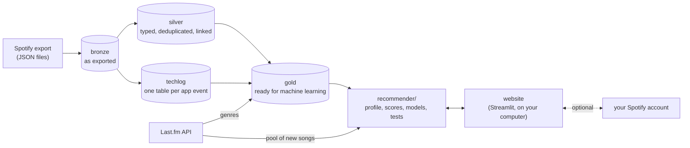

# Music Preference

**Build a music recommender from your own Spotify history: a data pipeline, models that learn your taste, and a small website, all running on your computer.**

    

Spotify lets you download everything it knows about your listening: every play for as long as you've had an account, when it started, how long you listened and how it ended. This project turns that download into a recommender for one person, you. It finds songs new to you, songs you loved and stopped playing, and songs like one you name. Then it learns from your likes and dislikes. The tutorial in [`docs/`](docs/) walks through building it step by step with your own data, and explains each idea along the way: cleaning messy exports, a medallion database, features without leakage, logistic regression, embeddings from co-occurrence, and evaluation that can't peek at the future.

## What you get

- **A clean database of your listening**: one [DuckDB](https://duckdb.org) file with three layers. *Bronze* keeps the exports as they came, *silver* has them typed, deduplicated and linked, and *gold* has tables ready for machine learning.
- **Genres for every song** from Last.fm tags, matched against MusicBrainz's genre list, and **a pool of tens of thousands of songs new to you**, from artists Last.fm links to yours.
- **Three kinds of recommendations**, each explained:
  - songs new to you, scored by genre, artist and Last.fm similarity, with dials for how mainstream, how familiar and which genres;
  - songs to rediscover, ranked by a model trained on your own history of going back to songs;
  - songs like one you name, from song vectors learned from what you play in the same sessions.
- **Models that learn from you**. A logistic regression learns your chance of going back to a song. Two more learn your chance of liking a song from your ratings, but only once they beat the hand-set score on ratings they haven't seen.
- **Honest evaluation**: time-ordered splits, replays of the past, rolling month-by-month checks, and rules fixed before looking at the results.
- **A local website**: song cards with Spotify's player, Like, Neutral and Dislike, saving to your Liked Songs or a playlist, charts of your listening, and a page that explains the models with their live weights.
- **Privacy by design**: everything runs on your computer. Your data, keys and settings are never committed, and a check before every commit makes sure of it.

## How it fits together



## Quick start

You need **Python 3.13**, your Spotify **Extended streaming history** (request it now: Spotify can take up to 30 days to send it), and a free **Last.fm API key**. [Chapter 1](docs/1-get-your-data.md) and [chapter 2](docs/2-set-up.md) explain each.

```bash
git clone https://github.com/Syakirin03/music-preference.git
cd music-preference
python -m venv .venv
source .venv/bin/activate          # Windows: .venv\Scripts\activate
pip install -r requirements.txt
cp config.example.toml config.toml # Windows: copy config.example.toml config.toml; then set your time zone in it

# Unzip your export into data/raw/ and save your Last.fm key in secrets/lastfm_api_key.txt, then:
python scripts/build_database.py   # exports -> bronze, silver, techlog (about 30 seconds)
python scripts/fetch_genres.py     # genres from Last.fm (about 2 requests per track, 4 a second; cached)
python scripts/build_gold.py       # the machine-learning tables (seconds)
python scripts/fetch_candidates.py # the pool of songs new to you (about 4,000 requests, 20 minutes; cached)
python -m recommender.ranker       # train the rediscover model (about a minute)
streamlit run app.py               # then open http://127.0.0.1:8501
```

## The tutorial

| Chapter | What you do | What you learn |
|---|---|---|
| [1. Get your data](docs/1-get-your-data.md) | Request and unzip your Spotify export | What Spotify records about every play |
| [2. Set up](docs/2-set-up.md) | Install Python packages, get API keys, write your settings | Keeping keys and personal settings out of code |
| [3. Build the database](docs/3-build-the-database.md) | Run the four pipeline scripts | Medallion architecture, cleaning, labels, leakage, time splits |
| [4. The recommender](docs/4-the-recommender.md) | Build your taste profile, train the models, run the tests | Scoring, logistic regression, embeddings, evaluating a recommender |
| [5. The website](docs/5-the-website.md) | Run the website and connect Spotify | A small app with Streamlit, and OAuth done safely |
| [6. Make it yours](docs/6-make-it-yours.md) | Change settings, try ideas, measure them | Experimenting without fooling yourself |

Reference: [the tables and their columns](docs/data-reference.md), [results on the author's data](docs/results.md), [privacy and security](docs/privacy.md). [`notebooks/01_explore_your_taste.ipynb`](notebooks/01_explore_your_taste.ipynb) explores your data before any modelling.

## Results on the author's data

One listener's history, tested on its last 10% of plays, which no model or setting saw while it was being chosen. Your numbers will differ: `python -m recommender.evaluate` measures yours.

| Task | The recommender | A simple baseline |
|---|---|---|
| Songs new to you: rank 31,106 unplayed songs, and see which ones were played later | AUC 0.90; 4.3 of the top 10 were played | random: AUC 0.50, none of the top 10 |
| Songs to rediscover: rank 552 dormant favourites, and see which ones were gone back to | learned model: AUC 0.82, 8 of the top 10 | hand-set formula: AUC 0.73, 5 of the top 10 |
| Your chance of liking a song new to you: predict each later rating from the earlier ones (188 ratings) | AUC 0.78 | the hand-set score: AUC 0.51 |
| Which new song will stick after its first listens | AUC 0.46: nothing in this data predicts it | |

The last row is why the website asks for ratings: your history tells well *what kind* of music you like, but not *which song* you'll love once you've heard it. [docs/results.md](docs/results.md) has every test, every setting and the rule that chose it, and what didn't work.

## Project layout

```
.
├── app.py                    the website's entry point: streamlit run app.py
├── app_pages/                its five pages, the shared state (common.py) and the look (look.py)
├── recommender/              the recommender package: data, profile, scores, models, evaluation, Spotify
├── scripts/                  the data pipeline: export -> database -> genres -> gold -> pool of new songs
├── notebooks/                exploratory analysis of your listening (saved without outputs)
├── tests/                    pytest suite on made-up data, plus the privacy checks
├── docs/                     the tutorial and the reference
├── data/                     your data, never committed: raw/, interim/, processed/, user/, external/
├── secrets/                  your API keys and Spotify login, never committed
├── reports/                  your own results and notes, never committed
├── static/                   the website's font and logo
├── .streamlit/config.toml    the website's theme; it only listens on your computer
├── .githooks/pre-commit      the privacy checks, before every commit
├── .github/workflows/ci.yml  lint and tests on every push
├── config.example.toml       your settings: copy it to config.toml
├── pyproject.toml            project metadata and tool settings
├── requirements.txt          the exact versions it runs with
└── requirements-dev.txt      tests, linter, notebook stripping
```

## Privacy

Your Spotify export holds every play with its time, your IP addresses, your email address and your device ids. All of it stays in `data/`, which git ignores, together with your keys (`secrets/`) and your settings (`config.toml`). Notebooks are committed without their outputs. A pre-commit check (`tests/test_privacy.py`) refuses a commit that would publish a file of yours, a key, a setting, or the name of an artist you play. The only things that leave your computer are the requests to Last.fm (names of songs and artists) and, from the website, to Spotify. [docs/privacy.md](docs/privacy.md) lists exactly what goes where.

## Development

```bash
pip install -r requirements-dev.txt
git config core.hooksPath .githooks   # the privacy checks run before every commit
nbstripout --install                  # notebook outputs are stripped as they are committed
pytest                                # unit tests, a pipeline test and a newcomer's history, all on made-up data
ruff check .
```

GitHub Actions runs the same lint and tests on every push. The tests never touch your data: they run on the default settings and a scratch folder, and the pipeline tests build databases from made-up exports.

## Credits

- Genres, similar artists and the pool of songs come from the [Last.fm API](https://www.last.fm/api). A tag counts as a genre when it is on [MusicBrainz](https://musicbrainz.org)'s genre list.
- The website shows [Spotify](https://developer.spotify.com)'s embedded player and uses the Spotify Web API. Spotify's terms forbid training models on its content, so the ids it returns are used only to play and save songs. This project isn't affiliated with Spotify or Last.fm.
- The website's typeface is [Inter](https://rsms.me/inter/) by Rasmus Andersson, under the SIL Open Font License (`static/fonts/Inter-LICENSE.txt`).
- Built with DuckDB, pandas, NumPy, SciPy, scikit-learn, Streamlit, Altair and Matplotlib.

The code is under the [MIT License](LICENSE).
