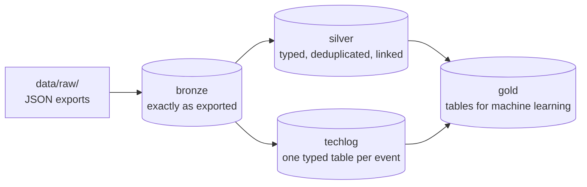

# 3. Build the database

Raw exports are messy: duplicated events, times in the wrong zone, plays that never really started, no genres. This chapter turns them into one clean database in four commands, and explains what each one does to the data and why.

| Step | Command | Reads | Writes | Time |
|---|---|---|---|---|
| 0 (optional) | `python scripts/extract_techlog_docs.py` | the technical log's ReadMe PDF | `data/external/techlog_docs.json` | seconds |
| 1 | `python scripts/build_database.py` | `data/raw/` | bronze, silver and techlog in `data/processed/spotify.duckdb` | about 30 s |
| 2 | `python scripts/fetch_genres.py` | silver, Last.fm | `data/processed/track_genres.csv` | about 2 requests per track, 4 a second; cached |
| 3 | `python scripts/build_gold.py` | silver, techlog, the genres | gold in `spotify.duckdb` | seconds |
| 4 | `python scripts/fetch_candidates.py` | gold, Last.fm | `data/processed/candidates.csv` | about 4,000 requests, 20 minutes; cached |

Every script prints `--help` from its own docstring, and every one can run again at any time: steps 1 and 3 rebuild their tables from scratch, in one transaction (a failed build leaves the database as it was), and steps 2 and 4 only ask Last.fm for what isn't cached yet.

## The medallion architecture

The database has layers, each built only from the one before. This common design is called the *medallion architecture*:



- **Bronze** keeps every record exactly as exported, duplicates included, with the file it came from. Nothing is ever lost, and every later layer can be rebuilt from it without going back to the JSON files.
- **Silver** is the cleaned version: proper types, clear names, duplicates gone, and foreign keys that link plays to tracks, and log events to devices and playbacks. DuckDB enforces them.
- **Techlog** holds one table per kind of technical-log event. These tables aren't written by hand: the build reads the structure of each event's JSON, infers each field's type, and detects which fields are times (epoch milliseconds, epoch seconds or ISO text).
- **Gold** holds the tables a model learns from: one row per play with its labels and point-in-time features, sessions as sequences, statistics per track, artist and genre.

All of it lives in one [DuckDB](https://duckdb.org) file: a database that runs inside Python, with no server, queried with SQL, and fast at exactly this kind of analysis.

## Step 0, optional: Spotify's descriptions of the technical log

If you have the technical log, its ReadMe PDF describes every event type and field. Extract them once, so that the build can store them as comments on the tables and columns:

```bash
python scripts/extract_techlog_docs.py
```

Without the technical log, skip this. The build then notes that the log tables have no descriptions.

## Step 1: bronze, silver and techlog

```bash
python scripts/build_database.py
```

What it does to your plays, in order:

1. **Loads every record as exported** into bronze.
2. **Drops exact duplicates.** Exports repeat some events word for word, and silver keeps one copy.
3. **Separates music from podcasts and audiobooks**, by which Spotify URI a record has.
4. **Collapses plays logged twice** with the same end second, keeping the longer record.
5. **Works out when each play started**, as `ts` minus `ms_played`, and its **local time** in your time zone (`config.toml`).
6. **Splits plays into listening sessions**: a pause of more than 30 minutes starts a new one (`SESSION_GAP_MINUTES`).

Here is what it printed for a made-up history of four and a half years (the tests build it):

```
Note: no technical log folder at data/raw/Spotify Technical Log Information; the log tables will be empty
Loaded 1 streaming history files (2020-03-02 to 2024-08-29)
  bronze.streams_raw         9,852  (as exported)
  silver.streams             9,852  (0 exact duplicates dropped)
  silver.plays               9,852  (music only; 0 same-second duplicate logs collapsed)
  silver.tracks                 80  (80 played, 0 only in the technical log)
  silver.episodes                0  (0 played, 0 only in the technical log)
Database: data/processed/spotify.duckdb
```

A real export shows duplicates dropped, podcasts set apart, and, with a technical log, the event tables and how many of the log's plays matched the streaming history. Lines starting with `WARNING:` point at anything unexpected, such as a field the build doesn't know or a time that didn't parse. Read them.

## Step 2: genres from Last.fm

```bash
python scripts/fetch_genres.py
```

Last.fm has no genre field, only tags its listeners give: "k-pop" and "pop", but also "seen live", "2019" or "favourites". A tag counts as a genre only if it is on MusicBrainz's list of about 2,200 genres (`data/external/musicbrainz_genres.txt`), on the script's own short lists (`EXTRA_GENRES`, `GENRE_ALIASES`), or in `[genres]` of your `config.toml`. Case, accents, spaces and punctuation are ignored, so "Hip-Hop", "hiphop" and "hip hop" are one genre. Tags weaker than a tenth of an item's strongest tag are dropped, since they are often one listener's idea.

Each track takes the genres of the first of these that has any:

1. **the track itself**, under its Spotify title and then under its *plain* title, without what Spotify adds to titles (" - Remastered 2011", " (feat. ...)");
2. **its album**;
3. **the artist's other tracks** here, their most common genres;
4. **the artist**: least reliable, because Last.fm has one page per artist *name*, so two artists with the same name share their tags.

The result, `track_genres.csv`, has one row per track: `genre` (the main one) and `genres` (all of them, main first, separated by `|`). Missing values are written `NA`. Expect a minority of tracks without any genre, often those of small artists that nobody tagged. Every answer is cached in `data/interim/lastfm_cache.jsonl`, so a run that stops resumes where it left off, and a run after a newer export only asks about new tracks.

## Step 3: gold, the tables for machine learning

```bash
python scripts/build_gold.py
```

For the same made-up history:

```
Gold layer built in data/processed/spotify.duckdb:
  gold.tracks                    80
  gold.track_genres             130
  gold.plays                  9,852
  gold.sessions               1,642
  gold.track_transitions      2,675
  gold.feedback_events            0
  gold.exposures                  0
  gold.track_stats               80
  gold.artists                    8
  gold.genres                    11
  gold.genre_months             338
  train split:   7,878 plays, 2020-03-02 to 2023-10-05
  valid split:     984 plays, 2023-10-06 to 2024-03-17
  test  split:     990 plays, 2024-03-18 to 2024-08-29
```

The ideas behind it are the ones any machine-learning dataset needs:

- **Labels: what counts as liking a play.** `end_type` says how it ended: `finished`, `skipped` (you pressed next or back, picked another song, or stopped) or `interrupted` (the app closed or the connection dropped, which says nothing about the song). `label` is 1 for finished, 0 for skipped within 30 seconds, and empty otherwise. `listen`, the number the recommender learns from, is 1 for finished, 0 for an early skip, and otherwise the share of the song you heard.
- **No leakage.** A feature may only use what was known when the play started. The `prev_*` and `*_prior_*` columns of `gold.plays` are built that way. The totals in `track_stats`, `artists`, `genres` and `genre_months` cover your whole history, including the future of any play, so they describe songs but must never be used to predict plays from the same period.
- **Splits in time order.** `split` gives whole sessions, in time order, to `train` (the oldest 80% of plays), `valid` (the next 10%, for choosing settings) and `test` (the newest 10%, for the honest final number). Shuffling plays at random would let a model learn from the future.
- **What isn't music.** Spotify publishes white noise, sleep sounds, audiobooks and recitations as music tracks. `is_music` is false for the tracks your `[not_music]` settings match, and the recommender leaves those out of your taste.
- **Affinity**, a simple implicit rating per track: its listens, each counting half as much for every 180 days of age.

The build checks itself: it stops if a table's key isn't unique, if a column has no description, or if `gold.plays`, `silver.plays` and the sessions disagree on the number of plays. Every table and column is described in the database:

```sql
SELECT table_name, column_name, comment FROM duckdb_columns() WHERE schema_name = 'gold'
```

## Step 4: a pool of songs new to you

```bash
python scripts/fetch_candidates.py
```

A recommender can only recommend what it knows about, and your history only holds songs you've played. This step builds the **pool** that songs new to you are chosen from:

1. **Seeds**: your 100 artists with the most listens, recent ones counting more.
2. **Similar artists**: the 400 artists Last.fm's similar-artist lists point to most strongly from your seeds.
3. **Genre artists**: Last.fm's 20 top artists of each of your 20 main genres, which reach artists your top artists don't lead to.
4. **Favourites** (optional): artists two steps out from the ones in `[pool]` of `config.toml`.
5. **A genre menu**: the top artists of 47 well-known genres, so that the website's *More of these genres* has songs in genres you barely play.
6. **Songs**: each artist's 50 most played songs on Last.fm, with the artist's genres and whether the artist makes Asian music (for the *Less Western* dial).

That makes tens of thousands of songs. The script writes three pools: **now**, for your recommendations, and **valid** and **test**, built from your top artists *as they were* at the start of those splits. With those, chapter 4 can replay the past honestly: the test ranks a pool that didn't know whom you came to like later. (Last.fm's lists themselves are today's, so the test is still a little too kind.) Steps 4 and 5 go into the now pool only, for the same reason. Songs you've played stay in the pool, because the recommender knows when you first played each one and leaves them out itself.

## Explore it

Before modelling, look at the data. [`notebooks/01_explore_your_taste.ipynb`](../notebooks/01_explore_your_taste.ipynb) goes through it the way a data scientist would: missing values and duplicates, standardising identifiers, cleaning and scaling features, encoding genres, patterns over time, and what your favourite songs share. Two of its decisions changed the recommender:

- **Versions of a song are one song.** Spotify often has one song under several track ids: single and album versions, re-releases, language versions, remixes. The recommender merges tracks with the same artist and the same plain title, so that a version of a song you know isn't offered to you as new.
- **Artists are told apart by their exact name**, letter case included. The exports have no artist ids, and two different artists can have names that differ only in case.

## Query it yourself

```python
import duckdb

con = duckdb.connect("data/processed/spotify.duckdb", read_only=True)

# Skip prediction: labelled plays with their point-in-time features, plus what each track is.
train = con.sql("""
    SELECT p.*, t.genres, t.est_duration_ms
    FROM gold.plays p JOIN gold.tracks t USING (track_id)
    WHERE p.split = 'train' AND p.label IS NOT NULL AND p.is_music
""").df()

# Next-track prediction: one sequence of track ids per session.
sequences = [row[0] for row in con.sql("SELECT track_ids FROM gold.sessions WHERE split = 'train' AND plays >= 2").fetchall()]

# Your listening by hour of the day, in your time zone.
con.sql("SELECT local_hour, count(*) AS plays FROM gold.plays WHERE is_music GROUP BY ALL ORDER BY 1").show()
```

Open connections with `read_only=True`, and close them before a build: DuckDB allows one writer at a time. [The data reference](data-reference.md) describes every table.

## After a newer export

Put the new export in `data/raw/` (or pass its folders with `--data-dir` and `--techlog-dir`), then run steps 1 to 4 again. Step 2 only looks up tracks that are new, and step 4 rebuilds the pools for your new dates.

Next: [4. The recommender](4-the-recommender.md).
